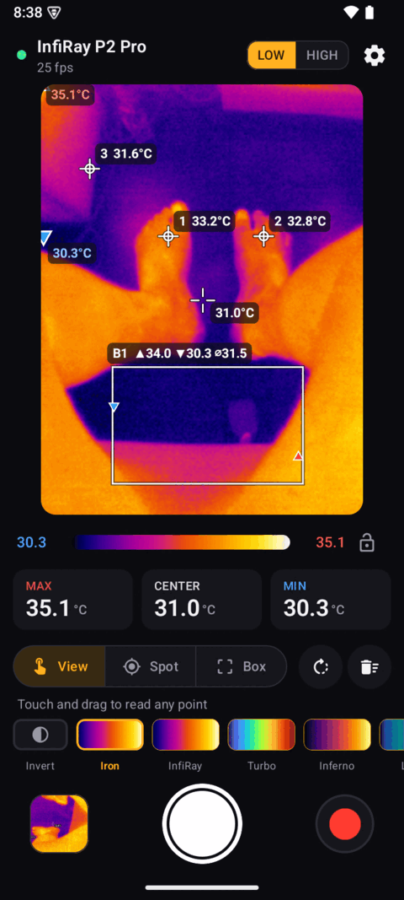
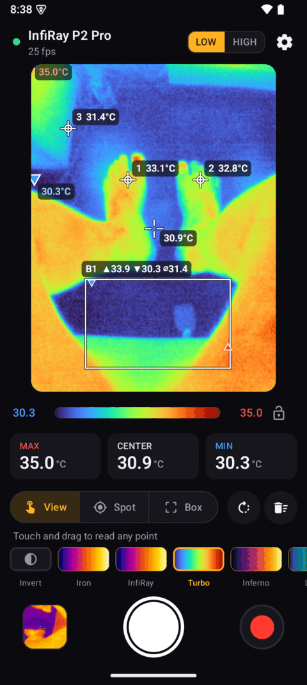
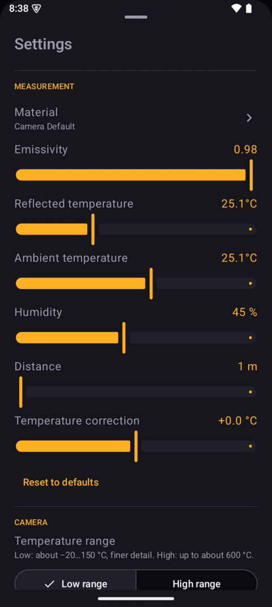

# IRCAM Thermal for Android

An Android app for USB thermal cameras, ported from
[ircam-linux](https://github.com/bigtimer-dev/ircam-linux), which ports
[OpenRMH-IRCAM](https://github.com/Cyclotronic/OpenRMH-IRCAM). Plug the camera into the phone's
USB-C port and the app opens with a live radiometric view.

## Screenshots

Live from an InfiRay P2 Pro on a Samsung Galaxy A04:

| Spots and a box (Iron palette) | Turbo palette | Settings |
|:---:|:---:|:---:|
|  |  |  |

## Install

Download `IRCAM-Thermal-<version>.apk` from the releases page, open it on the phone and allow
installing from that source. Android 10 or newer is required, and the phone must support USB OTG (host).

## Supported cameras

This first version supports the **pool 2** family: InfiRay P2 / P2 Pro / Tiny1-C and TOPDON TC001
(USB `0bda:5830`). Other cameras that stream 256×384 YUYV with the same layout should work too.
Temperature range switching (Low/High) works on the P2 Pro.

Tested with an InfiRay P2 Pro on a Samsung Galaxy A04 (MediaTek MT6765, Android 15 GSI) at 25 fps.

## Features

- Live view with hottest, coldest and centre markers and large readouts
- Touch and drag anywhere to read a single pixel
- Up to 10 spots and 10 boxes (max / min / average). Drag to move, drag a corner to resize, long-press to delete
- 50 palettes from the original program, palette inversion, smooth or pixel view, sharpening, rotation, mirror
- Colour range: automatic, locked to the current span, or typed in
- Emissivity with a searchable table of materials, plus reflected/ambient temperature, humidity,
  distance and temperature correction
- Snapshots: the image with its overlay, plus `SnapShotRAW_*.png` with the full temperature data. The RAW
  file is byte-compatible with ircam-linux and the Windows app.
- Gallery with snapshot analysis. Open a RAW snapshot to change the palette, add spots/boxes and
  adjust emissivity afterwards, then save or share the result
- Video recording (H.264 MP4 with the overlay)
- °C / °F / K, portrait and landscape layouts, and a demo camera for trying the app without hardware

Files are saved to `Pictures/IRCAM` and `Movies/IRCAM`.

## Building

Requirements: JDK 17, Android SDK 35, NDK 27.2.12479018 and CMake 3.22.1.

```sh
./gradlew assembleRelease     # app/build/outputs/apk/release/app-release.apk
./gradlew testDebugUnitTest   # temperature maths checked against ircam-linux
```

Release builds are signed with `release.keystore` from the project root when that file exists
(password from `IRCAM_KS_PASS`). Without it they are signed with the debug key.

## How it works

Android does not give apps access to `/dev/video*`. The app opens the camera through `UsbManager`
and passes the file descriptor to a small native UVC client (`app/src/main/cpp/uvc.c`) built on a
vendored libusb 1.0.27. That client negotiates the 256×384 YUYV stream and reassembles the
isochronous or bulk payloads into frames. The temperature maths in `thermal/Thermal.kt` is a
line-by-line port of ircam-linux `thermal.py`. Unit tests compare it with values computed by the
Python code (`tools/make_test_vectors.py`). The P2 Pro range switch uses the camera's vendor
mailbox protocol (from p2pro-rs), sent through `UsbDeviceConnection.controlTransfer`.

## License

MIT (see `LICENSE`). libusb is LGPL-2.1 (`app/src/main/cpp/libusb/COPYING`).
